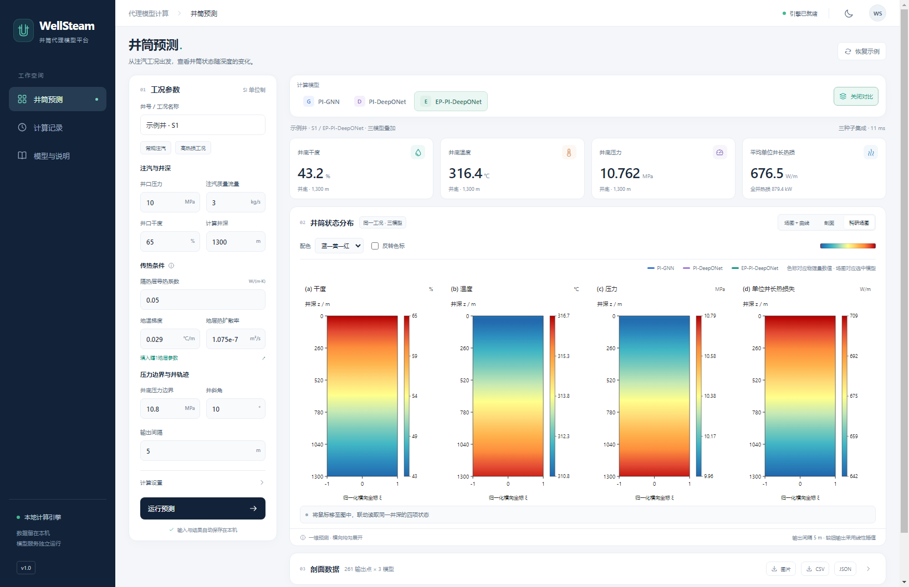
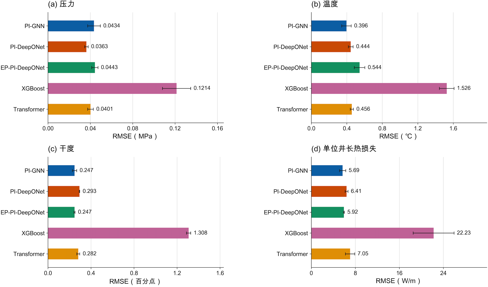
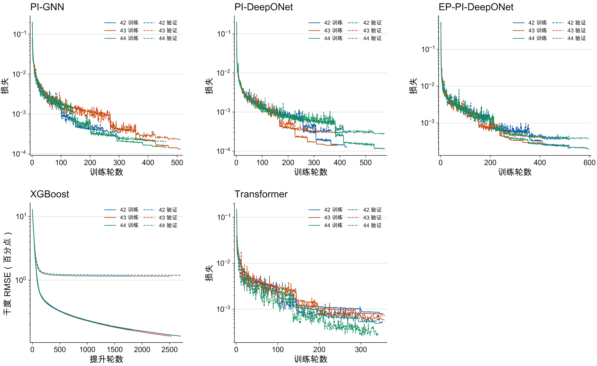
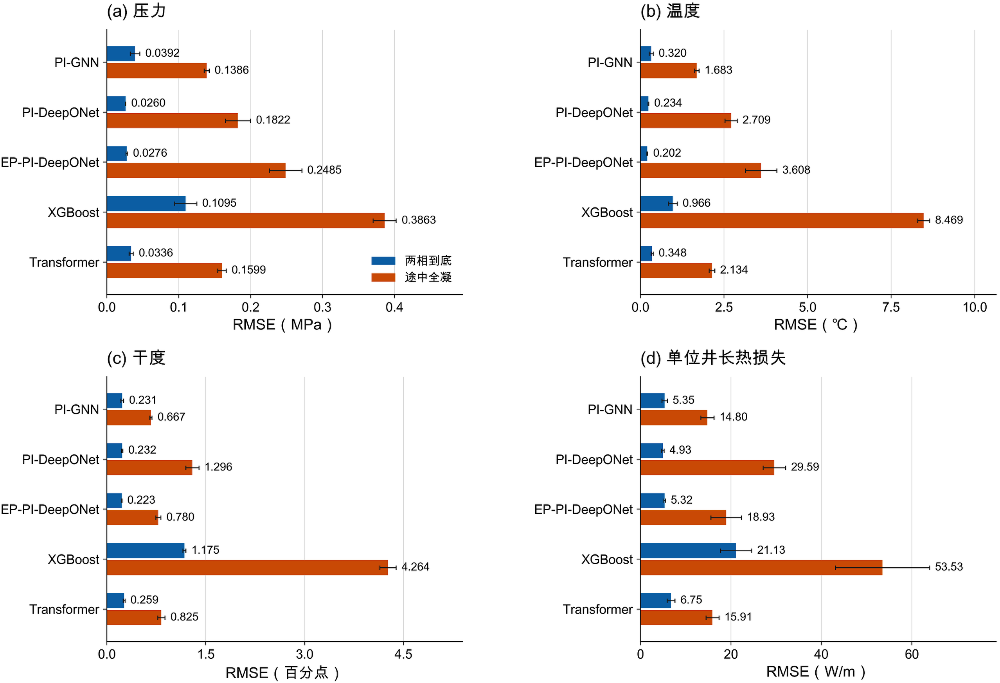
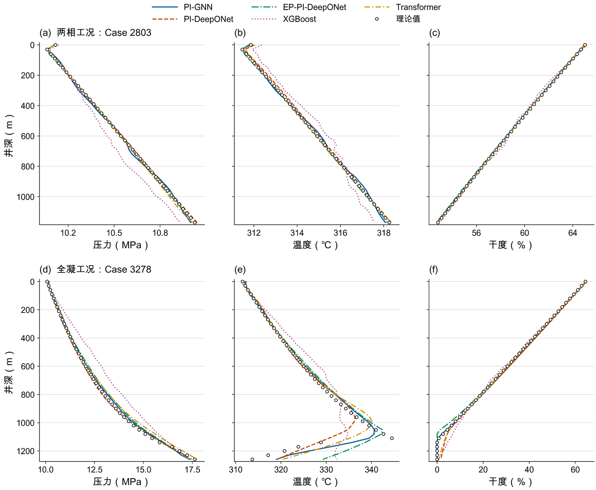

# WellSteam · 井筒代理模型计算平台

**严禁商用。仅限非商业科研、教学与个人学习。** 详见 [非商业使用许可](LICENSE.txt)。

WellSteam 面向稠油热采注汽井，输入井口工况、井深、地层与压力边界等参数，即可快速预测沿井深的**压力、温度、蒸汽干度和单位井长热损失**。软件集成三个正式代理模型，支持在同一界面切换模型和叠加比较，安装后可离线计算。

[下载 Windows v1.0 安装包](https://github.com/13PG/WellSteam/releases/latest) · [使用说明](docs/使用说明.md)

## 应用场景

- 非商业科研中快速比较不同注汽工况下的井筒参数分布。
- 查看温度、压力、干度及热损失的井深剖面与科研配色场图。
- 对比不同代理模型的预测结果，辅助模型研究、教学演示和参数分析。
- 导出 CSV、JSON 和图片，用于后续科研分析与非商业报告。

本版本提供固定工况下的井深剖面预测，不提供时序演化求解或逐井参数反演。场图是一维井深预测结果的横向展开，横向不代表真实径向温度场。

## 数据与训练背景

本项目以**辽河油田历年真实测试报告及井筒实测资料**为研究基础，结合可用观测进行参数标定和工况构建，再由井筒机理模型生成训练样本，训练物理约束代理模型。

因此，本软件是“**真实现场资料支撑 + 机理模拟生成样本 + 代理模型训练**”的研究成果，不应理解为全部训练样本都是现场直接测得的完整剖面。现场报告、逐井数据、训练集、源码和独立模型权重均不在本公开仓库中发布。

## 集成模型

| 模型 | 方法特点 |
|---|---|
| PI-GNN | 利用井深节点之间的图连接与物理约束学习剖面关系 |
| PI-DeepONet | 利用工况分支与位置分支学习从输入条件到井深剖面的映射 |
| EP-PI-DeepONet | 在 DeepONet 中融合焓与物性层，结合物理约束还原温度、干度等输出 |

XGBoost 和 Transformer 仅在下方实验结果中作为对比基线，不包含在软件的模型切换列表中。

## 模型训练与测试效果

以下四张图直接取自项目最新核对后的汇报 PPT。实验采用 **5504 个训练工况、1172 个验证工况**；五种模型统一在 **1178 个有效合成测试工况**上评价，其中两相到底工况 1155 个、途中全凝工况 23 个。

每项 RMSE 为随机种子 42、43、44 各自测试 RMSE 的平均值，误差棒表示种子间标准差。**这里的误差反映对机理模型合成参考值的拟合程度，不代表现场真实井预测误差，也不是百分比准确率。** 对比基线的历史训练协议存在差异，不能将这组图视为所有模型训练条件完全一致的严格消融实验。

### 总体测试 RMSE

| 模型 | 压力（MPa） | 温度（℃） | 干度（百分点） | 单位井长热损失（W/m） |
|---|---:|---:|---:|---:|
| PI-GNN | 0.0434 | 0.396 | 0.247 | 5.69 |
| PI-DeepONet | 0.0363 | 0.444 | 0.293 | 6.41 |
| EP-PI-DeepONet | 0.0443 | 0.544 | 0.247 | 5.92 |
| XGBoost（对比） | 0.1214 | 1.526 | 1.308 | 22.23 |
| Transformer（对比） | 0.0401 | 0.456 | 0.282 | 7.05 |

### 训练与验证收敛

各模型的损失定义与量纲不同，应分别观察各自的下降和收敛趋势，不能直接用不同子图的损失绝对值判断模型优劣。

### 两相与全凝工况

EP-PI-DeepONet 在两相到底组的温度和干度误差较低；途中全凝组中，PI-GNN 在四项指标上表现更好。目前没有一个模型在所有工况和所有指标上全面最优。

### 代表工况剖面

图中“理论值”为机理模型生成的参考值，不是现场实测值；曲线展示三个种子的平均预测结果。

## Windows 安装与使用

1. 在 [Releases](https://github.com/13PG/WellSteam/releases/latest) 下载 `WellSteam-Setup-1.0.0-win64.exe`，并同时阅读非商业使用许可。
2. 在 **Windows 10/11 64 位系统**运行安装包，安装完成后打开 WellSteam。
3. 输入工况、选择模型、填写输出间隔，点击“运行预测”。
4. 查看剖面、调整场图配色，或开启“三模型对比”，按需导出结果。

安装包已包含 Python、CPU 版 PyTorch、桌面运行库及正式模型，不需要用户安装 Python、CUDA、配置开发环境或运行 `build.bat`。Windows 安装包不能在 macOS 上直接运行。

输出间隔以 **m** 为单位，允许 1–1000 m。较细输出采用插值，模型原生计算网格约为 30 m；填写 5 m 不意味着增加了模型原生分辨率。热损失的单位始终是 W/m。

## 本仓库公开范围

此仓库用于**软件发布、使用说明和效果展示**，不提供源码构建包。仅公开文档、许可和展示图片；安装包发布在 GitHub Release**[现已删除，如有需要请联系我]**。

源码、原始测试报告、训练数据、独立模型权重、标准化参数、开发环境、计算历史和本机导出结果通过 `.gitignore` 白名单方式排除，不提交到公开代码库。为支持离线运行，安装包内部仍包含必要模型文件；打包不等于加密。

## 使用边界

软件结果依赖现有训练范围和固定管柱等假设。超出训练范围的工况、其他区域井及实际工程应用，需要额外验证；合成测试集上的低误差不等同于真实井精度保证。

**本软件严禁商用。** 第三方组件遵循各自许可，详见随安装包提供的说明。
